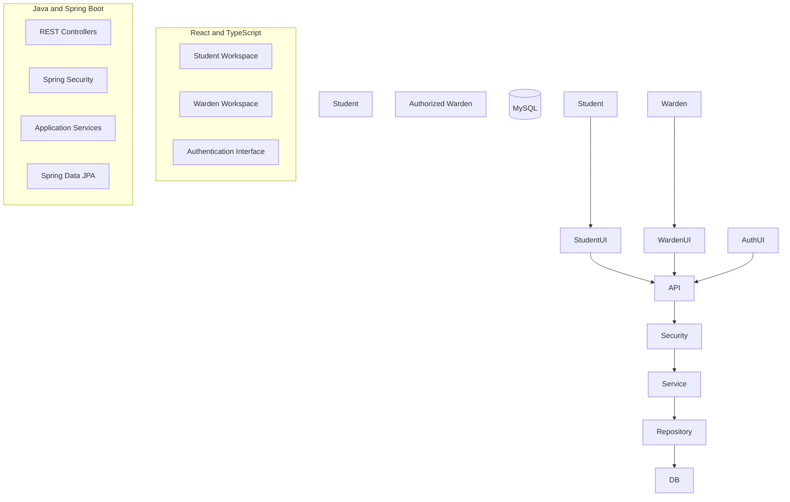

# HOSTEL HELP

## Design and Development of a Student-to-Student Borrowing and Peer-Support Platform

**Institution:** Uganda Christian University  
**Faculty:** Faculty of Engineering, Design and Technology  
**Programme:** Bachelor of Science in Information Technology  
**Course:** Object-Oriented Programming  
**Academic Year:** 2026

### Group Members

|No.|Group Member|Registration Number|
|-|-|-|
|1|Nakaayi Shamirah|M25B13/031|
|2|Kasana Brenda Daphine|S25B13/115|
|3|Benjamin Akampurira|M25B13/012|
|4|Aheebwa Abraham|S24B13/042|
| 5|Nankwanga Fridah|M25B13/033|
|6|Ayebale Samuel|S25B13/029|

# ABSTRACT

Hostel Help is a student-to-student borrowing and peer-support platform intended to help students request and lend everyday items within a university community. Students can request items, offer assistance, accept offers, manage borrowing activities, confirm receipt and return, and rate helpers. The application also provides an authorized warden workspace for viewing member information and managing incident reports.

The known technology stack includes Java 21, Spring Boot, Spring Data JPA, Spring Security, Flyway, MySQL, React, TypeScript, and Vite. The frontend communicates with the backend through REST endpoints, while the backend manages application logic, access control, and database operations.

This project demonstrates the development of a web application using object-oriented programming and a separated frontend/backend architecture. Actual implementation details and testing results must be verified against the current code before final submission.

**Keywords:** Hostel Help, student borrowing, peer support, Java, Spring Boot, React, MySQL, OOP.

# CHAPTER ONE: INTRODUCTION

## 1.1 Background

Students living in university hostels may sometimes need everyday items that they do not currently possess. Examples may include chargers, stationery, torches, or other personal and academic items. Students commonly seek assistance from friends, roommates, or other nearby students.

Informal borrowing may not provide a centralized way to publish requests, discover available help, track accepted arrangements, or record return confirmations. Hostel Help is intended to provide an organized platform for these activities and to support peer assistance within the student community.

## 1.2 Problem Statement

Students may rely on informal communication to borrow items. Such arrangements can make it difficult to organize requests and offers, keep track of accepted borrowing arrangements, and confirm whether borrowed items have been returned. There is therefore a need for an organized platform through which students can request items, offer assistance, and manage borrowing activities. Hostel Help addresses this need through a web application with student borrowing functionality and a warden workspace for member information and incident reports.

## 1.3 Main Objective

To design and develop a student-to-student borrowing and peer-support platform that facilitates requesting, offering, managing, and tracking borrowed items within a university hostel community.

## 1.4 Specific Objectives

1. Provide student registration and authentication.
2. Enable students to create and manage borrowing requests.
3. Enable students to submit offers in response to requests.
4. Support acceptance and management of offers.
5. Support borrowing, receipt, and return tracking.
6. Provide helper rating functionality.
7. Provide relevant notifications.
8. Provide an authorized warden workspace for member-directory and incident-report management.
9. Apply object-oriented programming concepts in the application.
10. Test the implementation and document verified results.

## 1.5 Scope

The project focuses on peer borrowing and assistance. Student functions include account access, requests, offers, borrowing management, receipt/return confirmation, ratings, and notifications, subject to the current implementation. Warden functions include authorized access to the member directory, member details, incident reports, report details, and report-status management.

The application is not an online shopping checkout or payment platform. Features not verified in the code—such as external SMS delivery, mobile applications, or public deployment—must not be described as implemented.

## 1.6 Significance

* **Students:** organized way to request items and offer help.
* **Community:** structured records for borrowing coordination.
* **Wardens:** access to member information and incident reports.
* **Developers:** practical experience with OOP, REST APIs, databases, and application security.

# CHAPTER TWO: SYSTEM ANALYSIS AND REQUIREMENTS

## 2.1 Users

**Student:** registers/authenticates, creates requests, views requests, submits offers, accepts offers, manages borrowing, confirms receipt/return, rates helpers, and accesses notifications.

**Authorized warden:** authenticates, views the member directory, accesses member details and incident reports, reviews report details, and manages report status.

## 2.2 Functional Requirements

|ID|Requirement|
|-|-|
|FR01|Students can register accounts.|
|FR02|Users can authenticate.|
|FR03|Access is controlled according to user role.|
|FR04|Students can create borrowing requests.|
|FR05|Students can view borrowing requests.|
|FR06|Students can submit offers.|
|FR07|Offers can be accepted or rejected according to application rules.|
|FR08|Borrowing activities can be managed.|
|FR09|Receipt and return can be confirmed.|
|FR10|Helper ratings can be submitted.|
|FR11|Relevant notifications are available.|
|FR12|Incident reporting is available where implemented.|
|FR13|Authorized wardens can view the member directory.|
|FR14|Authorized wardens can view incident reports.|
|FR15|Authorized wardens can manage report status.|
|FR16|Warden functions are restricted to authorized accounts.|
|FR17|Application data is stored in a relational database.|

**Verification:** Mark each requirement Implemented / Partial / Not implemented after inspecting and testing the current application.

## 2.3 Non-Functional Requirements

* **Security:** authentication, authorization, and protection of credentials.
* **Usability:** understandable navigation and clear operation feedback.
* **Maintainability:** separation of frontend, backend, and database responsibilities.
* **Reliability:** validation and appropriate error handling.
* **Data integrity:** consistent relationships between users, requests, offers, borrowing records, ratings, notifications, and reports.
* **Performance:** reasonable response times, to be evaluated through testing.

## 2.4 Software Requirements

* Java Development Kit 21
* Spring Boot
* Spring Data JPA
* Spring Security
* Flyway
* MySQL
* Node.js and npm
* React
* TypeScript
* Vite
* Maven Wrapper
* Web browser
* Visual Studio Code or another editor

## 2.5 System Overview

The frontend provides the user interface. The backend REST API validates requests, applies business rules, performs authentication and authorization, and accesses MySQL. Flyway manages database migrations. Exact tables, relationships, and route names must be confirmed from repository files.

# CHAPTER THREE: SYSTEM DESIGN AND ARCHITECTURE

## 3.1 Architecture

The system follows a client-server architecture. React/TypeScript frontend requests are sent to the Spring Boot REST API. The backend applies security and application logic and uses Spring Data JPA to interact with MySQL.

## 3.2 Frontend

React and TypeScript provide the user interface. Vite provides the development and build tooling. The student and warden workspaces expose role-appropriate functionality. The frontend should communicate with the backend API rather than directly accessing MySQL.

## 3.3 Backend

Java 21 and Spring Boot provide the REST API. The backend processes requests, validates input, applies business rules, manages security, and accesses persistent data. Exact controller, service, repository, entity, and DTO names should be copied from source code.

## 3.4 Database

MySQL stores application records. The known domain includes users/student profiles, requests, offers, borrowing transactions, ratings, notifications, and incident reports. The final database diagram must use exact tables and foreign-key relationships from Flyway migrations.

## 3.5 Authentication and Authorization

The project information indicates Spring Security, server-side sessions, BCrypt password handling, and student/warden role separation. Verify these in the security configuration. Warden accounts are provisioned through server-side configuration rather than public student registration, according to the current project notes. Never put credentials in documentation.

## 3.6 Main Domain Concepts

Conceptual entities include User, Student/profile, Request, Offer, Borrowing, Rating, Notification, and Report. These names are provisional: the final class diagram must use actual Java classes and their real relationships.

# CHAPTER FOUR: IMPLEMENTATION

## 4.1 Backend

The backend is built with Java 21 and Spring Boot. It exposes REST endpoints and processes application operations. Spring Data JPA provides database interaction, Spring Security handles authentication/authorization, and Flyway manages migrations. Insert exact source-file names after inspecting the repository.

## 4.2 Frontend

The frontend is built with React, TypeScript, and Vite. It provides the student workspace and warden workspace and communicates with the backend through REST requests. Insert screenshots from the running application.

## 4.3 Student Workspace

The intended student workflow includes requests, offers, offer acceptance, borrowing management, receipt/return confirmation, ratings, and notifications. Verify each feature and capture evidence before claiming it in the final report.

## 4.4 Warden Workspace

The current project discussion confirms that the warden workspace is working and can display member information and incident-report details. The workspace includes member-directory access and report management. Capture screenshots and verify authorization behavior for submission.

## 4.5 Object-Oriented Design

The project uses Java and object-oriented application structure. The final report must cite actual classes for encapsulation, abstraction, inheritance, polymorphism, interfaces, and exception handling. Do not claim a specific class relationship without source evidence.

# CHAPTER FIVE: TESTING AND RESULTS

Testing should cover student registration/login, requests, offers, borrowing, receipt/return, ratings, notifications, warden login, member directory, report details, report-status updates, and role restrictions.

Automated tests should be executed using the project's Maven Wrapper. Frontend build/lint commands must be read from `frontend/package.json`. Record actual output, test counts, date, and screenshots. Do not mark tests passed until executed.

# CHAPTER SIX: CONCLUSION AND RECOMMENDATIONS

## 6.1 Conclusion

Hostel Help is intended to organize student-to-student borrowing and peer support through a web application. Students can use the platform to request items, offer help, and manage borrowing activities. The warden workspace provides authorized access to member information and incident reports. The project uses a frontend/backend architecture and technologies including Java, Spring Boot, React, TypeScript, and MySQL. The final academic report should be supported by verified source evidence, screenshots, and test results.

## 6.2 Recommendations

1. Perform further usability testing with students and wardens.
2. Expand automated testing.
3. Continue improving validation and error handling.
4. Review authentication and authorization.
5. Document backup and recovery procedures.
6. Consider deployment to an appropriate hosting environment.
7. Improve the application based on actual user feedback.

## 

